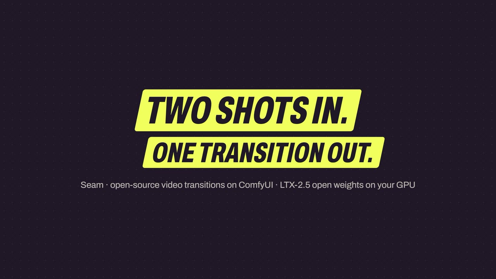
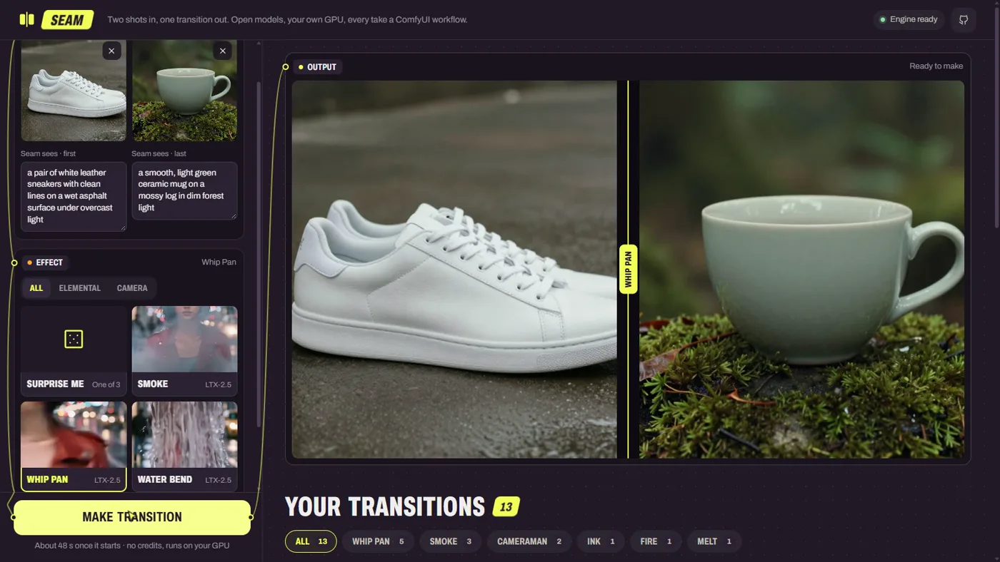
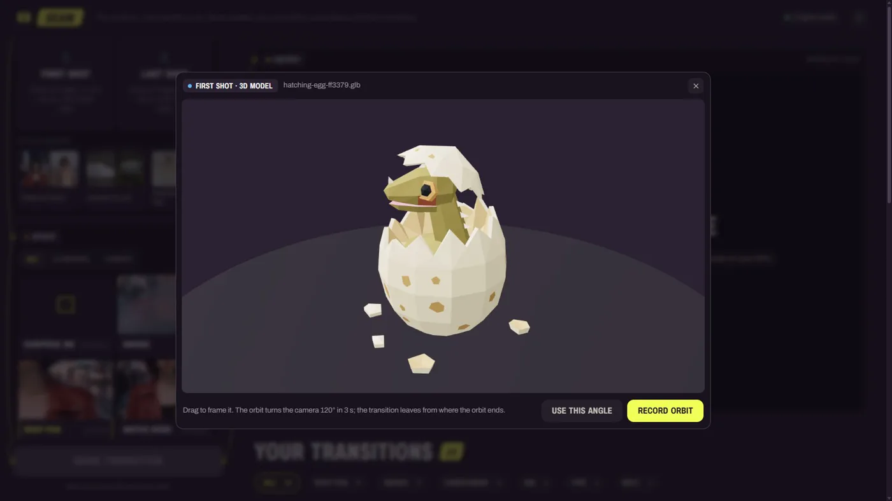
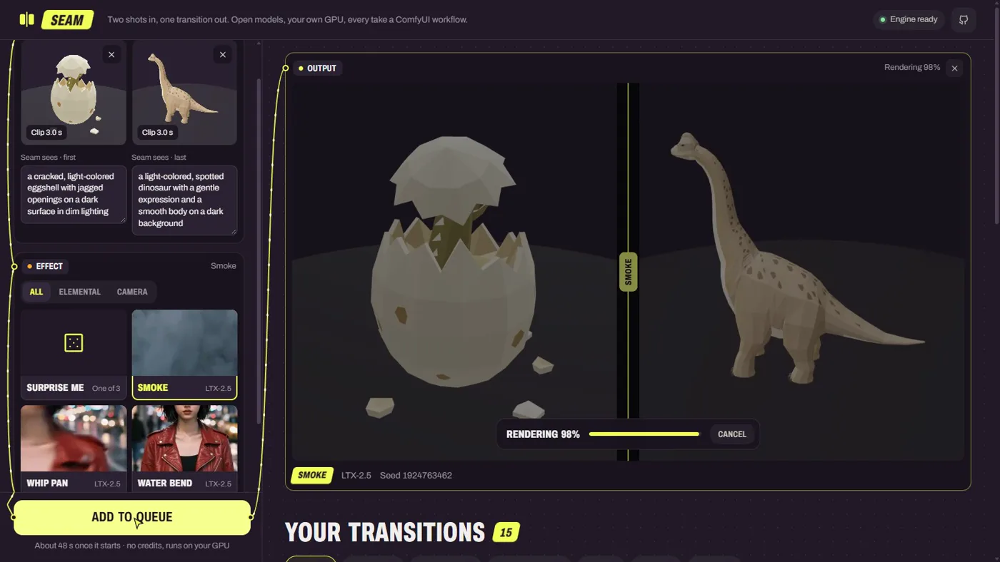
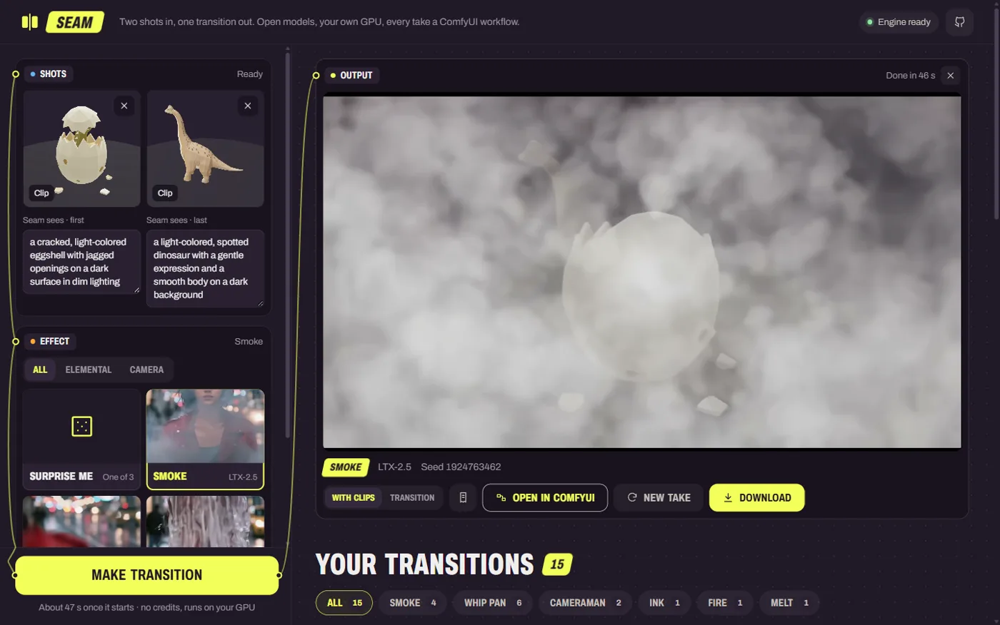
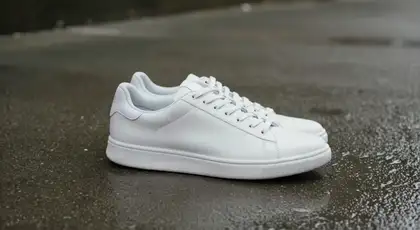

<p align="center">
  
</p>

<h3 align="center">Two shots in. One transition out.</h3>

<p align="center">
  Drop two images, two clips or two 3D models. Pick an effect. An open-weights video model renders the in-between
  on your own GPU, through ComfyUI. Every take is a ComfyUI workflow you can open.
</p>

<p align="center">
  <a href="LICENSE"></a>
  <a href="#how-it-works"></a>
  <a href="#how-it-works"></a>
  <a href="#models-and-licenses"></a>
  <a href="#hackathon-submission"></a>
</p>

<p align="center">
  <a href="docs/media/seam-demo.mp4"></a>
  <br>
  <b><a href="docs/media/seam-demo.mp4">▶ Watch the 2-minute demo</a></b> · <a href="https://jdnichollsc.github.io/seam/">Project site</a> · <a href="install.md">Install</a>
</p>

---

Seam is an open-source take on the "transitions" apps (Higgsfield, Kling, Pika), built for Comfy's
[Open Source Higgsfield](https://comfy.org/open-source-higgsfield) challenge. No accounts, no credits: the
model runs on your machine and every take can be reopened, inspected and re-run in ComfyUI.

- **Web studio**: shots on the left, the take on the right, your gallery below. Images, 1–6 s clips or **3D models**
  as input, ten qualified effects (5 s takes, 10 s for Smoke, Water bend and Whip pan) or **Surprise me**, and three examples so you can try it in one click.
- **Sequences**: more than two shots? Put them in order, pick an effect per hand-off, and Seam renders each
  transition and joins them into one video (clips play in full at their place). A bad hand-off gets a new take on
  its own; the others are reused. Or grow a story shot by shot: **Continue** a finished two-shot take with a new
  shot, then keep adding; only the new transition renders, and every transition starts from your own shot, so the
  story stays as consistent as the shots you bring.
- **CLI**: `seam make first.png last.png --preset smoke`, `seam sequence make 1.png 2.png 3.png --preset smoke,whip_pan`, then `seam sequence extend <id> 4.png --preset ink`, and `seam sequence edit <id> --order 1,3,2,4 --transition 1=ink --transition 2=melt --transition 3=smoke` to reorder (only the new hand-offs render).
- **Agent plugin**: a skill + MCP server so Claude Code (or any MCP agent) can plan, render, review and refine
  transitions for you. Packaged as a Claude Code plugin and as an [Agent Plugins](https://agent-plugins.org/) 1.0 plugin.

## Why it's different

| | |
|---|---|
| **Generative, not a 2D blend** | Code tools (ffmpeg `xfade`, Remotion) cross-fade two flat frames. Seam asks a video model for what is *between* the shots: smoke that really hides the subject, water that reshapes into the next scene, a pan with real parallax and motion blur. |
| **Any shot in, even 3D** | Images, clips, or a `.glb` you frame in the browser and record as a camera orbit. Everything becomes the frame the transition leaves from or lands on, so clips and orbits stay continuous. |
| **Open by default** | Open weights (LTX-2.5, Gemma-4 E2B), core ComfyUI nodes, the official Comfy SDK. Each take archives the exact graph it submitted; **Open in ComfyUI** downloads it with both shots, and a receipt says how it was made. |
| **Only qualified effects ship** | An effect is exposed only after it plays well on two image pairs × two seeds, then on unseen pairs. Ten passed; more ship only if they pass too. Longer takes are qualified the same way, per effect. |
| **Seam reads your shots** | A small local model describes each shot ("a cracked eggshell with jagged openings…") and that line goes into the prompt. You can correct it before you render. |
| **Agents included** | The same server backs the web app, the CLI and an MCP server, so an agent can run the whole loop: plan, render, look at the take, refine. |

## Tour

<table>
  <tr>
    <td width="50%"></td>
    <td width="50%"></td>
  </tr>
  <tr>
    <td><b>Try an example</b> or drop your own shots. The Effect node plays each effect's preview on hover.</td>
    <td><b>3D model in.</b> Frame the <code>.glb</code>, then <b>Record orbit</b> (3 s, 120°) or keep one angle as a still.</td>
  </tr>
  <tr>
    <td></td>
    <td></td>
  </tr>
  <tr>
    <td><b>Make transition.</b> The graph's wires carry the take into Output while LTX-2.5 renders (~45 s on an RTX 5090).</td>
    <td><b>The take.</b> With clips or transition only, open the exact workflow in ComfyUI, make a new take, download.</td>
  </tr>
</table>

The studio is styled after comfy.org: Comfy ink and yellow, condensed type, and ComfyUI's own node-and-wire
language (socket colours by type). Design notes: [DESIGN.md](DESIGN.md).

## Takes

All real renders, seed 1, no retouching. The input stills are fictional and were generated for testing.

**A person** (first shot → Seam → last shot)

| First shot | Smoke | Water bend | Whip pan | Last shot |
|---|---|---|---|---|
|  |  |  |  |  |

**A product** (sneaker on wet concrete → cup on a mossy rock)

| Smoke | Water bend | Whip pan |
|---|---|---|
|  |  |  |

**3D models** — the egg and the brachiosaurus at the top of this page: two `.glb` files, two recorded orbits, one take.

**Measured** (RTX 5090 32 GB, Windows 11, ComfyUI Desktop 0.41.3; 5 s clips at 1280×704 or 704×1280):

| Effect | Takes | Render time, median (min–max) |
|---|---|---|
| Smoke | 10 | 41 s (30–46 s) |
| Water bend | 9 | 40 s (30–41 s) |
| Whip pan | 9 | 41 s (30–56 s) |
| Lava, Beast, Ink, Light burst, Zoom through, Melt, Wind vortex | 4 each | 38–43 s (35–47 s) |
| Smoke, Water bend, Whip pan at **10 s** | 18 | 76 s (71–86 s) |

Render time runs from submit to finished video, including LTX-2.5's prompt enhancer and any model loading (the
slowest takes were the first after a load). Reading the two shots (~1 s each, cached) comes on top. Peak VRAM was
~31 GB on a 32 GB card; 24 GB cards should work through ComfyUI's offloading (64 GB RAM) but are untested.
The qualification record is [dev/PRESET_REVIEW.md](dev/PRESET_REVIEW.md).

## 3D models in

Drop a `.glb` on either shot. Seam opens it in a small 3D studio in the browser (three.js): neutral set, studio
light, the model framed for you; drag to change the angle.

- **Record orbit** renders a 3 s, 120° camera orbit and uploads it as a clip. The transition **leaves from where the
  first orbit ends** and **lands where the second orbit begins**, and Seam joins orbit + transition + orbit into one
  video. The orbit is paced by the clock, so a slow GPU drops frames but the clip still lasts 3 s.
- **Use this angle** keeps one view as a still.

The model never leaves your machine; only the recorded orbit or still goes to the Seam server, like any upload.

## Hackathon submission

| | |
|---|---|
| Category fit | **Open Weights Only**: every render is LTX-2.5 (+ Gemma-4 E2B to read the shots) on your own GPU through core ComfyUI nodes; no partner nodes, no closed APIs. **VFX Workflow built with LTX**: LTX-2.5 first/last-frame is the core model of every effect. |
| Comfy Developer Platform | Every render goes through the official **Comfy SDK** to the **Comfy API v2** (`comfy-api-proxy` locally). |
| Workflow files | [`src/seam/workflows/`](src/seam/workflows) (API format, slot-mapped), and any take exports its exact graph via **Open in ComfyUI**. |
| Run it locally | [install.md](install.md), checked end to end by `uv run seam doctor`. |
| Try it | The app ships three example pairs: open the studio and pick one. There is no hosted endpoint: Seam runs on your GPU. |
| Demo | [docs/media/seam-demo.mp4](docs/media/seam-demo.mp4) (1:56, real renders, waits sped up and labelled). |

## Quick start

You need an NVIDIA GPU with 32 GB (24 GB untested), 64 GB RAM, ComfyUI ≥ 0.41.3, Python 3.12 with `uv`, Node 20+
and ffmpeg. The full guide, written so an agent can follow it too, is **[install.md](install.md)**.

```bash
git clone https://github.com/jdnichollsc/seam && cd seam
uv run python scripts/download_models.py --models-dir "<ComfyUI>/models" --only l25   # ~44 GB, open weights

uv tool install comfy-api-proxy==0.1.6
comfy-api-proxy start --comfyui http://127.0.0.1:8188                                  # Comfy API v2 on :8189

uv run seam doctor     # checks ffmpeg, the Comfy API, nodes, models and the web build
uv run seam serve      # http://127.0.0.1:7860
```

**Agents.** In Claude Code:

```bash
claude plugin marketplace add jdnichollsc/seam
claude plugin install seam
```

Then ask for a transition ("make a smoke transition from a.png to b.png and show me a preview"). The MCP server
exposes `seam_status`, `list_presets`, `create_transition`, `wait_job`, `preview_job`, `refine_job`, `get_job`,
`list_jobs` and `cancel_job`, plus `create_sequence`, `wait_sequence`, `get_sequence`, `preview_sequence`,
`refine_segment`, `cancel_sequence`, `continue_take`, `extend_sequence` and `edit_sequence` (remove / reorder
shots, a story line for the whole film) for multi-shot videos; the skill tells the agent how to plan shots, judge a take and refine it.

## How it works

```
browser / CLI / agent (MCP)
        │  REST + live events
   Seam server (FastAPI) ── presets → model-specific prompt + slot-mapped workflow
        │  Comfy SDK  (comfy-sdk, Comfy API v2)
   comfy-api-proxy  →  ComfyUI (core nodes only)  →  LTX-2.5 on your GPU
```

- Every generation goes through the official **Comfy SDK** against the **Comfy API v2**, served locally by
  `comfy-api-proxy`. The same client can point at Comfy Cloud or a deployed endpoint through `COMFY_BASE_URL`
  (not tested yet).
- Each effect is a preset (our own prompt text) routed to the model that renders it best: **LTX-2.5** first/last-frame
  with its in-graph prompt enhancer (every launch effect), or **LTX-2.3** with an open transition LoRA.
- Seam reads both shots first with the same small local model as the enhancer (Gemma-4 E2B), so the prompt says
  what is in them. You can correct that line before rendering.
- Workflows are the official ComfyUI templates exported to API format; Seam only touches them through a named
  slot map, with a test that fails if the template drifts.
- Jobs persist in SQLite and survive a server restart (they re-attach to the running ComfyUI job, and a job that was
  mid-submit is reported, never silently resubmitted).
- **Clips in, clips out:** either side can be a 1–6 s clip (normalized to one clock on upload). The transition starts
  from clip A's last frame and lands on clip B's first, and Seam joins clip A + transition + clip B with ffmpeg.
- **Every take is reproducible:** a receipt (input hashes, effect, model, seed, final prompt, graph hash) and a
  one-click **Open in ComfyUI** bundle: the exact API workflow plus both stills, runnable in plain ComfyUI.
- The server only answers on loopback and refuses cross-site writes.

## Built with

| Tool | What it does in Seam |
|---|---|
| [ComfyUI](https://github.com/comfyanonymous/ComfyUI) | runs the graphs (core nodes only, the official LTX-2.5 first/last-frame template) |
| [Comfy SDK](https://github.com/Comfy-Org/comfy-python-sdk) + [comfy-api-proxy](https://github.com/Comfy-Org/comfy-api-proxy) | every submit, upload and download, over the Comfy API v2 |
| [LTX-2.5](https://github.com/Lightricks/LTX-2) | the video model, with its in-graph prompt enhancer |
| Gemma-4 E2B | reads each shot so the prompt describes it |
| FastAPI · SQLite · ffmpeg | the Seam server, job store, clip normalization and joins |
| React · GSAP · three.js | the web studio, its motion, and the 3D-model studio |
| MCP · Agent skills | the agent plugin (Claude Code, Agent Plugins) |

## Models and licenses

| Model | Role | License |
|---|---|---|
| [LTX-2.5](https://huggingface.co/Lightricks/LTX-2.5) 22B distilled (int8) + VAEs | default video model | LTX-2.x Community License (gated) |
| Gemma-4 12B (LTX-2.5 text encoder) · Gemma-4 E2B (prompt enhancer) | text encoding / prompt enhancement | Gemma terms |
| [LTX-2.3](https://huggingface.co/Lightricks/LTX-2.3-fp8) 22B distilled fp8 + Gemma-3 12B | optional video model | LTX-2 Community License |
| [LTX-2.3 Transition LoRA](https://huggingface.co/valiantcat/LTX-2.3-Transition-LORA) | optional transition style | see model card |
| Z-Image-Turbo | only used to generate the fictional test images in `dev/` | see model card |

Seam's code is MIT ([LICENSE](LICENSE)). The models keep their own licenses; read them before commercial use.
The effect presets are our own text, inspired by common transition concepts — no third-party prompts or media.
The 3D models (`.glb`) in the demo are the author's own assets, released under MIT.

**Status:** tested on Windows 11 with one RTX 5090. Linux, macOS and smaller GPUs are untested.

## Responsible use

Use images you own or made. Don't put a real, identifiable person into a transition without their permission.
Keep it SFW.

## Credits

Built on [ComfyUI](https://github.com/comfyanonymous/ComfyUI), the [Comfy SDK](https://github.com/Comfy-Org/comfy-python-sdk)
and [comfy-api-proxy](https://github.com/Comfy-Org/comfy-api-proxy), [LTX](https://github.com/Lightricks/LTX-2) by
Lightricks, and the open transition LoRA by valiantcat. Made for [#OpenSourceHiggsfield](https://comfy.org/open-source-higgsfield)
by [@jdnichollsc](https://github.com/jdnichollsc).
